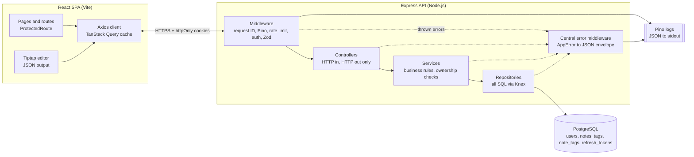
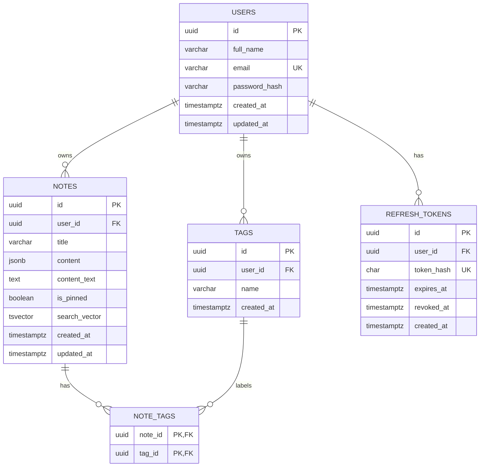
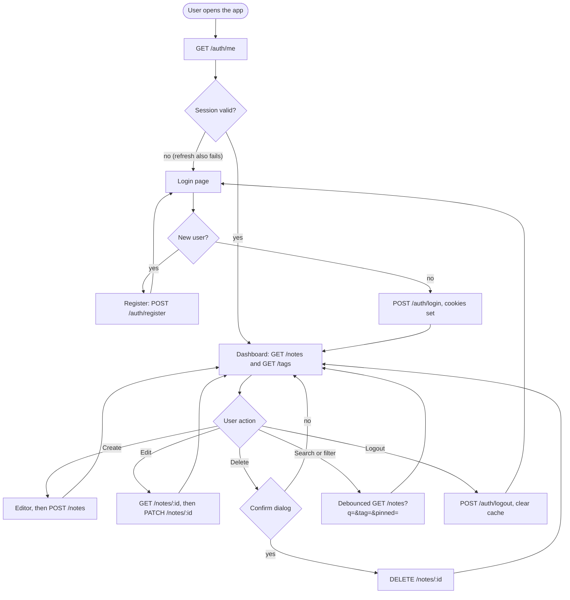
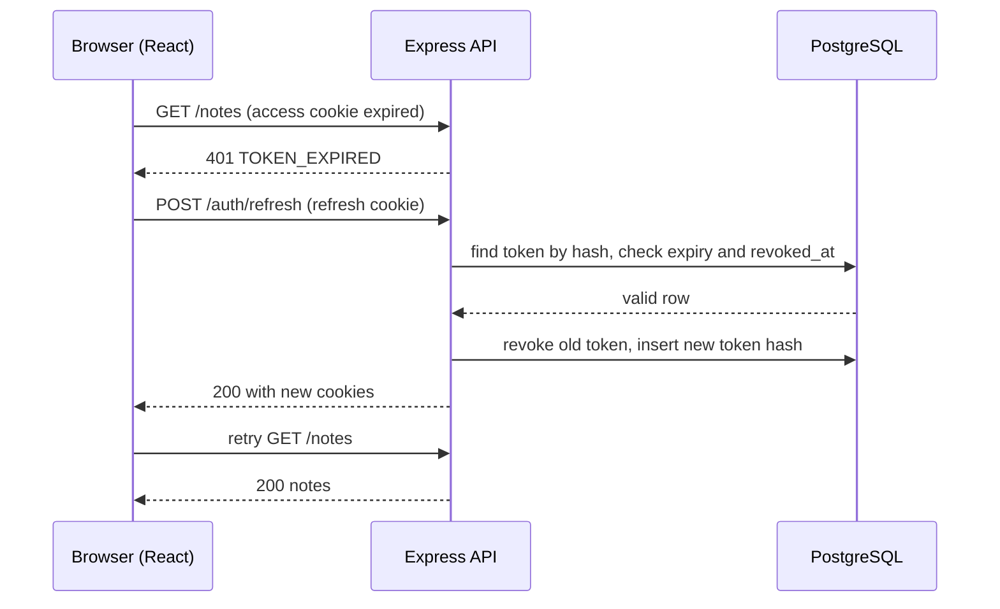
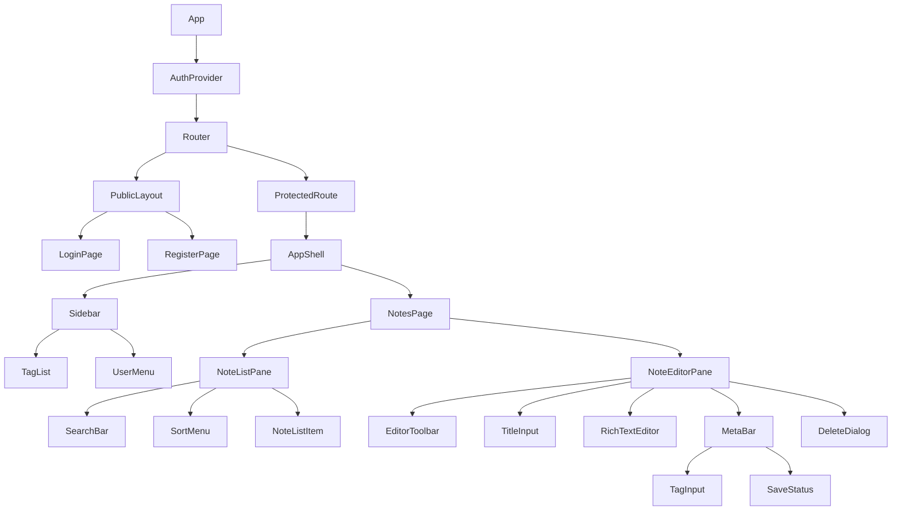

# Notes App — System Design & Technical Architecture Document

*Prepared for Muhammad Anas · 10Pearls Shine Program, Cohort 10 (MERN) · Phase 01 · Version 1.0 · 16 November 2026*

**Legend used throughout this document**

- **\[ASSIGNMENT\]** means the requirement comes directly from the internship brief. It is not negotiable.
- **\[RECOMMENDATION\]** means it is my engineering suggestion. You may change it, but you must be able to defend the change.
- **Simple explanation** boxes are written so you can defend the decision in a mentor discussion.

## 1. Executive Summary

The Notes App is a multi-user web application where each authenticated user can securely create, read, update, delete, search and filter their own rich-text notes. The assignment is small in features but large in engineering expectations: the mentors will evaluate architecture, security, logging, testing, code quality and Git discipline more than the number of features.

**Core design decisions (summary)**

| Area | Decision | Type |
| --- | --- | --- |
| Frontend | React (Vite), JavaScript, React Router, Tailwind CSS with shadcn-style primitives adapted from 21st.dev, Tiptap rich-text editor | Stack is ASSIGNMENT; libraries are RECOMMENDATION |
| Backend | Node.js + Express, layered architecture (routes → controllers → services → repositories) | ASSIGNMENT + RECOMMENDATION |
| Database | PostgreSQL | ASSIGNMENT allows MySQL or PostgreSQL; PostgreSQL is my choice |
| Data access | Knex.js (query builder + migrations), no heavy ORM | RECOMMENDATION |
| Auth | bcrypt password hashing, short-lived JWT access token and rotating refresh token, both in httpOnly cookies | RECOMMENDATION |
| Validation | Zod schemas in middleware | RECOMMENDATION |
| Logging | Pino + pino-http with redaction | ASSIGNMENT |
| Testing | Mocha + Chai (+ Sinon, Supertest, c8) backend; Jest + React Testing Library frontend | ASSIGNMENT |
| Quality | SonarQube with lcov coverage reports, CodeRabbit on the PR | ASSIGNMENT |
| Search | PostgreSQL full-text search (tsvector + GIN index) | RECOMMENDATION |

**Scope discipline.** Mandatory features come first. Socket.IO, import/export and advanced search are optional and are deliberately excluded from the core roadmap until everything mandatory is complete, tested and reviewed.

> **Simple explanation:** Yeh project CRUD se zyada "professional engineering" dikhane ke liye hai. Isliye hum har layer (routes, controllers, services, repositories) alag rakhte hain, har input validate karte hain, har error ek jagah handle karte hain, aur har cheez test karte hain.

## 2. Requirement Specification

### 2.1 Functional Requirements

**Authentication \[ASSIGNMENT\]**

| ID | Requirement |
| --- | --- |
| FR-A1 | A visitor can register with full name, email and password. |
| FR-A2 | Email must be unique (case-insensitive). Duplicate registration is rejected. |
| FR-A3 | A registered user can log in with email and password. |
| FR-A4 | A logged-in user can log out; the session is invalidated server-side. |
| FR-A5 | Passwords are stored only as salted hashes. |
| FR-A6 | All notes endpoints require authentication. |
| FR-A7 | A user can only access their own notes (authorization by ownership). |

**Notes management \[ASSIGNMENT\]**

| ID | Requirement |
| --- | --- |
| FR-N1 | Create a note with a title and rich-text content. |
| FR-N2 | List the current user's notes (paginated, sorted). |
| FR-N3 | View a single note. |
| FR-N4 | Edit title and content of a note. |
| FR-N5 | Delete a note after explicit confirmation. |
| FR-N6 | Rich-text editing: headings, bold, italic, underline, lists, links, code block, blockquote. |
| FR-N7 | Search notes by keyword across title and content. |
| FR-N8 | Filter notes. **Assumption:** filtering is by tag and pinned status, plus sorting by updated or created date (see Section 13, question Q3). |

**Recommended additions (small, justified)**

| ID | Requirement | Why |
| --- | --- | --- |
| FR-R1 | Tags on notes (create inline, filter by tag). | Gives "filtering" a real meaning and demonstrates a many-to-many relationship, which the brief asks for ("proper database relationships"). |
| FR-R2 | Pin a note to the top. | Cheap, useful, and demonstrates a filter. |
| FR-R3 | Current-user endpoint (`GET /auth/me`). | The frontend needs it to restore the session on page reload. |
| FR-R4 | Health endpoint (`GET /health`). | Needed for deployment checks and monitoring. |

**Optional features \[ASSIGNMENT, optional\]:** real-time updates (Socket.IO), import/export, advanced search. These are out of scope until all mandatory items are done (Phase 12 in the roadmap).

### 2.2 Non-Functional Requirements

| Category | Requirement |
| --- | --- |
| Security | OWASP Top 10 awareness: hashed passwords, parameterized queries, input validation and sanitization, rate limiting, secure cookies, Helmet headers, strict CORS, no secrets in the repository. |
| Performance | Note list responds in under 300 ms for 1,000 notes per user on a normal development machine. Pagination is mandatory. Search uses an index, not `LIKE '%term%'` scans. |
| Reliability | Consistent JSON error format. No unhandled promise rejections. Graceful shutdown (close HTTP server and DB pool). |
| Maintainability | Layered architecture, no business logic in controllers, ESLint + Prettier, small functions, documented decisions. |
| Observability | Structured JSON logs with request IDs, redaction of sensitive fields, log levels by environment. |
| Testability | Services and repositories are injectable so they can be unit tested with stubs. Separate test database. |
| Usability and accessibility | Responsive from 360 px to desktop. WCAG 2.1 AA targets: keyboard navigation, visible focus, labels, contrast 4.5:1, ARIA live regions for status messages. |
| Portability | Environment-based configuration. Database migrations make setup reproducible with one command. |
| Quality gates | SonarQube quality gate passes; coverage target 80% or higher on new code; zero critical or high issues before mentor review. |

### 2.3 User Roles and Permissions

Only **one role** is required: **Authenticated User**. A role table or RBAC system would be overengineering for this assignment.

| Actor | Can do | Cannot do |
| --- | --- | --- |
| Anonymous visitor | Register, log in, view public pages (login/register) | Access any note or user data |
| Authenticated user | Full CRUD on **own** notes and tags, view own profile, log out | See, edit or delete another user's notes |

If a user requests another user's note, the API returns **404 Not Found** (not 403). This avoids revealing that the note exists.

> **Simple explanation:** Authentication = "tum kaun ho?". Authorization = "tum yeh cheez kar sakte ho?". Hum har note query mein `user_id` condition lagate hain, taake koi dusre ka note dekh hi na sake.

### 2.4 Constraints

- Must use React, Node.js, Express and PostgreSQL or MySQL **\[ASSIGNMENT\]**.
- Must use Pino, Mocha + Chai, Jest, SonarQube, Git/GitHub, CodeRabbit **\[ASSIGNMENT\]**.
- JavaScript, not TypeScript, unless the mentor approves otherwise.
- Work happens on feature branches in the fork; the PR targets the original 10Pearls repository.
- No MongoDB. The brief requires a relational database with proper relationships.

### 2.5 Assumptions

1. The repository is nearly empty (a starter or README only). **I have not inspected it.** Phase 02 begins with a repository inspection.
2. Node.js 20 LTS or newer and PostgreSQL 15 or newer are available locally (Docker is acceptable).
3. The app is deployed for demonstration only, with a single backend instance.
4. Email verification and password reset are **not** required. They are out of scope.
5. Notes are private. Sharing notes between users is out of scope.
6. The frontend and backend run on different origins in development (for example `localhost:5173` and `localhost:4000`).

### 2.6 Risks and Mitigations

| Risk | Impact | Mitigation |
| --- | --- | --- |
| XSS through rich-text content | Account takeover | Store editor content as structured JSON, render through the editor schema (not `dangerouslySetInnerHTML`), restrict link protocols to `http`, `https`, `mailto`. |
| JWT stored in `localStorage` | Token theft via XSS | Use httpOnly cookies. |
| CSRF when using cookies | Unwanted state changes | SameSite cookies, strict CORS with credentials, Origin check and a required custom header on mutating requests. |
| Brute-force login | Account compromise | Rate limiting on auth routes, generic error messages, bcrypt cost factor 12. |
| Scope creep into optional features | Mandatory work incomplete | Roadmap places optional features last, behind a mentor checkpoint. |
| Test setup friction (Jest with Vite, Mocha with ES modules) | Lost time | Decide module system early (Section 12); set up test tooling in Phase 02 before features. |
| AI agent generating fake or untested code | Quality failures | Small phased prompts, mandatory test runs, "never claim tests passed without running them" rule in every prompt. |
| Large rich-text payloads | Slow API, abuse | Express body limit (for example 256 KB), content length validation. |

## 3. System Architecture

### 3.1 Overall Style

A **three-tier architecture**: a React single-page application (presentation), an Express REST API (application/business logic), and PostgreSQL (data). The backend uses a **layered architecture** inside a single deployable unit (a modular monolith). Microservices would be unjustified for this scope.

**Figure 1 — System architecture diagram**



### 3.2 Frontend Architecture \[RECOMMENDATION\]

- **Build tool:** Vite with React 18 and JavaScript.
- **Routing:** React Router. Public routes (`/login`, `/register`) and protected routes (`/notes`, `/notes/:id`) wrapped in a `ProtectedRoute` component.
- **Server state:** TanStack Query for fetching, caching, loading and error states, and cache invalidation after mutations. This removes a lot of hand-written `useEffect` code.
- **Client state:** React Context for authentication only (current user and status). No Redux; it is unnecessary here.
- **HTTP client:** one Axios instance with `withCredentials: true`, a response interceptor that attempts one silent token refresh on a 401, and an error normalizer.
- **Forms:** React Hook Form with Zod resolvers (the same validation vocabulary as the backend).
- **Styling:** Tailwind CSS with a small set of design tokens (Section 8). Components are adapted from 21st.dev, not pasted unchanged.
- **Editor:** Tiptap (ProseMirror based). It outputs JSON, which is safer than raw HTML.
- **Structure:** feature-based folders (`features/auth`, `features/notes`) with shared `components/ui`, `lib`, and `hooks`.

### 3.3 Backend Architecture \[RECOMMENDATION within ASSIGNMENT\]

Request flow:

`Route → Middleware (request ID, logger, rate limit, auth, validation) → Controller → Service → Repository → Database`

| Layer | Responsibility | Must not |
| --- | --- | --- |
| Routes | Map URL and method to middleware chain and controller. | Contain logic. |
| Middleware | Cross-cutting concerns: authentication, validation, rate limiting, request logging. | Contain business rules. |
| Controllers | Read validated input from the request, call a service, shape the HTTP response. | Contain business logic or SQL. |
| Services | Business rules: hashing, token issuing, ownership checks, deriving plain text from editor JSON, tag handling. | Touch `req` or `res`. |
| Repositories | All SQL through Knex. Return plain objects. | Contain business rules. |
| Error middleware | Convert any thrown error into a consistent HTTP response and a log entry. | Leak stack traces in production. |

> **Simple explanation:** Controller sirf "darwaza" hai: request leta hai aur response deta hai. Asal kaam service karti hai, aur database ki baat sirf repository karti hai. Is se testing aasaan hoti hai, kyunke har layer ko alag stub kar ke test kar sakte hain.

### 3.4 Database Architecture

Single PostgreSQL instance with a connection pool (`pg` through Knex). Schema changes only through versioned Knex migrations. Seed data only in development. Separate databases for development and test. Details in Section 4.

### 3.5 Authentication Flow (overview)

Full detail is in Section 6. In short: login returns two httpOnly cookies, a 15-minute **access token** (JWT) and a 7-day **refresh token** (random opaque string whose SHA-256 hash is stored in the database). When the access token expires, the frontend calls `/auth/refresh`, which rotates the refresh token. Logout revokes the refresh token and clears both cookies.

### 3.6 Frontend–Backend Communication

- JSON over HTTPS, REST, versioned under `/api/v1`.
- Cookies sent automatically with `withCredentials`.
- Mutating requests (POST, PATCH, DELETE) include a custom header `X-Requested-With: notes-app`; the server rejects mutating requests without it (a simple, effective CSRF defense together with SameSite).
- A uniform response envelope (Section 5.1).
- In development, Vite proxies `/api` to the backend, which removes CORS complexity locally. Production CORS allows only the configured frontend origin.

### 3.7 Error Handling Architecture

1. A custom `AppError` class carries `statusCode`, a stable machine-readable `code`, a safe `message`, and optional `details`. Subclasses: `ValidationError` (400), `AuthenticationError` (401), `NotFoundError` (404), `ConflictError` (409), `RateLimitError` (429).
2. Services and repositories throw errors; they never write HTTP responses.
3. An async handler wrapper forwards rejected promises to Express error middleware.
4. The centralized error middleware: logs the error (warn for expected 4xx, error for 5xx with stack), maps database errors (for example unique violation `23505` to 409), and returns the standard error envelope with the request ID. In production, 500 responses carry a generic message only.
5. `unhandledRejection` and `uncaughtException` handlers log at `fatal` level and shut down gracefully.
6. On the frontend, a global error boundary handles render crashes; the Axios interceptor normalizes API errors; each form shows field-level errors from `details`.

### 3.8 Logging Architecture (overview)

Pino is the single logger. `pino-http` logs each request/response with a request ID (generated or taken from `X-Request-Id`). A child logger carrying the request ID is attached to `req.log` so service-level logs can be correlated. Sensitive fields are redacted at the logger level. Detail in Section 9.

## 4. Database Design

### 4.1 MySQL vs PostgreSQL

| Criteria | MySQL | PostgreSQL |
| --- | --- | --- |
| Full-text search | Available (FULLTEXT index), more limited ranking and language control | Rich: `tsvector`, ranking, weights, GIN indexes, language configs |
| JSON support | JSON type, limited indexing options | `JSONB` with GIN indexing and powerful operators |
| Standards compliance and constraints | Good; historically looser defaults | Strict, with strong constraint and `CHECK` support |
| UUID generation | Needs `UUID()` with binary tricks for efficiency | Native `uuid` type, `gen_random_uuid()` |
| Generated columns | Supported | Supported (`GENERATED ALWAYS AS ... STORED`) |
| Ecosystem for Node | Excellent | Excellent (`pg`, Knex) |
| Hosting for demos | Widely available | Widely available (Neon, Supabase, Render, Railway free tiers) |

**Decision: PostgreSQL.** Reasons: (1) a note app needs good text search, and PostgreSQL gives ranked full-text search without an extra service; (2) `JSONB` suits rich-text editor documents; (3) strict constraints protect data integrity; (4) a native UUID type. MySQL would also satisfy the assignment, so if your mentor prefers MySQL, only the search and JSON parts of the design change.

> **Simple explanation:** Dono databases assignment mein allowed hain. Hum PostgreSQL isliye le rahe hain ke is mein search aur rich-text JSON store karna zyada behtar hai, aur extra tool (jaise Elasticsearch) ki zaroorat nahi padti.

### 4.2 Entities and Relationships

- A **user** has many **notes** (1 to many).
- A **user** has many **tags** (1 to many). Tags are per-user so users cannot see each other's tag names.
- A **note** has many **tags** and a **tag** belongs to many **notes** (many to many through `note_tags`).
- A **user** has many **refresh tokens** (1 to many), used for session management and secure logout.

**Figure 2 — Entity relationship diagram**



### 4.3 Table Structures

**`users`**

| Column | Type | Constraints |
| --- | --- | --- |
| id | UUID | PK, default `gen_random_uuid()` |
| full\_name | VARCHAR(100) | NOT NULL, CHECK length ≥ 2 |
| email | VARCHAR(255) | NOT NULL; unique index on `lower(email)` |
| password\_hash | VARCHAR(255) | NOT NULL |
| created\_at | TIMESTAMPTZ | NOT NULL, default `now()` |
| updated\_at | TIMESTAMPTZ | NOT NULL, default `now()` (trigger-maintained) |

**`notes`**

| Column | Type | Constraints |
| --- | --- | --- |
| id | UUID | PK, default `gen_random_uuid()` |
| user\_id | UUID | NOT NULL, FK → `users.id` ON DELETE CASCADE |
| title | VARCHAR(200) | NOT NULL, CHECK length(trim(title)) ≥ 1 |
| content | JSONB | NOT NULL (Tiptap document JSON) |
| content\_text | TEXT | NOT NULL, default `''` (plain text derived by the service; used for search and previews) |
| is\_pinned | BOOLEAN | NOT NULL, default `false` |
| search\_vector | TSVECTOR | Generated, stored: weight A on title, weight B on `content_text` |
| created\_at | TIMESTAMPTZ | NOT NULL, default `now()` |
| updated\_at | TIMESTAMPTZ | NOT NULL, default `now()` (trigger-maintained) |

**`tags`**

| Column | Type | Constraints |
| --- | --- | --- |
| id | UUID | PK |
| user\_id | UUID | NOT NULL, FK → `users.id` ON DELETE CASCADE |
| name | VARCHAR(30) | NOT NULL, CHECK length(trim(name)) ≥ 1; unique on `(user_id, lower(name))` |
| created\_at | TIMESTAMPTZ | NOT NULL, default `now()` |

**`note_tags`** (junction)

| Column | Type | Constraints |
| --- | --- | --- |
| note\_id | UUID | FK → `notes.id` ON DELETE CASCADE |
| tag\_id | UUID | FK → `tags.id` ON DELETE CASCADE |
|  |  | Composite PK `(note_id, tag_id)` |

The rule "a note may only use tags owned by the same user" is enforced in the service layer (and covered by tests). A stricter database-level alternative is a composite foreign key including `user_id`; it is noted as an optional hardening step.

**`refresh_tokens`**

| Column | Type | Constraints |
| --- | --- | --- |
| id | UUID | PK |
| user\_id | UUID | NOT NULL, FK → `users.id` ON DELETE CASCADE |
| token\_hash | CHAR(64) | NOT NULL, UNIQUE (SHA-256 of the opaque token) |
| expires\_at | TIMESTAMPTZ | NOT NULL |
| revoked\_at | TIMESTAMPTZ | NULL (set on logout or rotation) |
| created\_at | TIMESTAMPTZ | NOT NULL, default `now()` |

### 4.4 Indexing Strategy

| Index | Purpose |
| --- | --- |
| `users`: unique on `lower(email)` | Fast login lookup and case-insensitive uniqueness |
| `notes`: `(user_id, updated_at DESC)` | Default listing: "my notes, newest first" |
| `notes`: `(user_id, is_pinned, updated_at DESC)` | Pinned filter and pinned-first ordering |
| `notes`: GIN on `search_vector` | Full-text search |
| `tags`: unique `(user_id, lower(name))` | Uniqueness and tag lookup by name |
| `note_tags`: index on `tag_id` | Filter notes by tag (the composite PK already covers `note_id` lookups) |
| `refresh_tokens`: unique on `token_hash`; index on `user_id` | Token lookup and revoking all sessions of a user |

Search queries combine `search_vector @@ websearch_to_tsquery('english', :q)` with a mandatory `user_id = :currentUser` filter, ranked by `ts_rank`.

### 4.5 Timestamps and Housekeeping

- All timestamps are `TIMESTAMPTZ` stored in UTC.
- `updated_at` is maintained by a shared database trigger function so it stays correct even for manual SQL.
- **Deletion policy \[RECOMMENDATION\]:** hard delete for notes, protected by a confirmation dialog in the UI. Soft delete or trash adds complexity not required by the brief (see Q4).
- A scheduled cleanup of expired refresh tokens is noted as a future improvement, not part of this assignment.

## 5. API Specification

### 5.1 Conventions \[RECOMMENDATION\]

- **Base path:** `/api/v1`. Versioning from day one avoids breaking clients later.
- **Format:** JSON only. Dates are ISO 8601 UTC strings. IDs are UUID strings. JSON keys are camelCase in the API even though database columns are snake\_case (the repository layer maps them).
- **Success envelope:** `{ "success": true, "data": ..., "meta": ... }` (`meta` only for lists).
- **Error envelope:** `{ "success": false, "error": { "code": "VALIDATION_ERROR", "message": "Human readable summary", "details": [ { "field": "email", "message": "Invalid email address" } ], "requestId": "..." } }`.
- **Authentication:** httpOnly cookies set by the server (Section 6). Endpoints marked *Auth: yes* return 401 without a valid access token.
- **Mutating requests** (POST, PATCH, DELETE) must carry the header `X-Requested-With: notes-app`; otherwise 403 `CSRF_REJECTED`.
- **Rate-limited responses** return 429 `RATE_LIMITED` with a `Retry-After` header.

**Stable error codes:** `VALIDATION_ERROR` (400), `UNAUTHENTICATED` (401), `INVALID_CREDENTIALS` (401), `TOKEN_EXPIRED` (401), `CSRF_REJECTED` (403), `NOT_FOUND` (404), `EMAIL_ALREADY_REGISTERED` (409), `PAYLOAD_TOO_LARGE` (413), `RATE_LIMITED` (429), `INTERNAL_ERROR` (500).

**Why PATCH and not PUT for editing?** PATCH sends only changed fields, which suits an editor with autosave and avoids overwriting fields the client did not load.

**Why 404 instead of 403 for another user's note?** A 403 would confirm that the note exists. 404 leaks nothing.

### 5.2 Endpoint Summary

| # | Method | URL | Purpose | Auth |
| --- | --- | --- | --- | --- |
| 1 | POST | `/auth/register` | Create an account | No |
| 2 | POST | `/auth/login` | Log in and set cookies | No |
| 3 | POST | `/auth/refresh` | Rotate refresh token, issue new access token | Refresh cookie |
| 4 | POST | `/auth/logout` | Revoke session, clear cookies | Yes |
| 5 | GET | `/auth/me` | Return the current user | Yes |
| 6 | GET | `/notes` | List, search and filter own notes | Yes |
| 7 | POST | `/notes` | Create a note | Yes |
| 8 | GET | `/notes/:id` | Get one note with full content | Yes |
| 9 | PATCH | `/notes/:id` | Update a note | Yes |
| 10 | DELETE | `/notes/:id` | Delete a note | Yes |
| 11 | GET | `/tags` | List own tags that are in use, with note counts | Yes |
| 12 | GET | `/health` | Liveness and database check | No |

### 5.3 Endpoint Details

**1. POST `/api/v1/auth/register`**

- Purpose: create a user account (FR-A1, FR-A2, FR-A5).
- Auth: no.
- Request: `{ "fullName": "Muhammad Anas", "email": "anas@example.com", "password": "Str0ngPass1" }`
- Validation: `fullName` trimmed, 2–100 characters. `email` valid format, maximum 255, normalized to lowercase. `password` 8–72 characters with at least one letter and one number (72 bytes is bcrypt's limit). Unknown fields are rejected.
- Success **201**: `{ "success": true, "data": { "user": { "id": "...", "fullName": "...", "email": "...", "createdAt": "..." } } }`. The user is not logged in automatically; the client redirects to login (simple and explicit). Auto-login is an acceptable alternative.
- Errors: 400 `VALIDATION_ERROR`; 409 `EMAIL_ALREADY_REGISTERED`; 429 `RATE_LIMITED`; 500.

**2. POST `/api/v1/auth/login`**

- Purpose: authenticate and start a session (FR-A3).
- Auth: no.
- Request: `{ "email": "...", "password": "..." }`
- Validation: both required, email format, password non-empty (length limits only, no complexity rules at login).
- Success **200**: sets `access_token` and `refresh_token` cookies; body `{ "success": true, "data": { "user": { ... } } }`. No token appears in the body.
- Errors: 400 `VALIDATION_ERROR`; 401 `INVALID_CREDENTIALS` (same message whether the email or the password is wrong); 429 `RATE_LIMITED`; 500.

**3. POST `/api/v1/auth/refresh`**

- Purpose: silently renew the session when the access token expires.
- Auth: valid `refresh_token` cookie.
- Request: empty body.
- Success **200**: new cookies (the refresh token is rotated); body `{ "success": true, "data": { "user": { ... } } }`.
- Errors: 401 `UNAUTHENTICATED` (missing, expired, revoked or unknown token; cookies are cleared); 429; 500.

**4. POST `/api/v1/auth/logout`**

- Purpose: end the session securely (FR-A4).
- Auth: yes (the refresh cookie is also read to revoke it).
- Request: empty body.
- Success **204**: no body; refresh token revoked in the database; both cookies cleared.
- Errors: 401 `UNAUTHENTICATED`; 403 `CSRF_REJECTED`; 500. Logout is idempotent: calling it with an already-revoked token still clears cookies and returns 204.

**5. GET `/api/v1/auth/me`**

- Purpose: restore the session on page load (FR-R3).
- Auth: yes.
- Success **200**: `{ "success": true, "data": { "user": { "id", "fullName", "email", "createdAt" } } }`.
- Errors: 401 `UNAUTHENTICATED` or `TOKEN_EXPIRED` (the client then tries `/auth/refresh` once); 500.

**6. GET `/api/v1/notes`**

- Purpose: list, search and filter the current user's notes (FR-N2, FR-N7, FR-N8).
- Auth: yes.
- Query parameters: `q` (search text, maximum 100), `tag` (tag name), `pinned` (`true` or `false`), `sort` (`updated_desc` default, `updated_asc`, `created_desc`, `created_asc`, `title_asc`, `relevance` only when `q` is present), `page` (integer ≥ 1, default 1), `limit` (1–50, default 20).
- Behavior: pinned notes come first unless `sort` is `relevance`. Results never include another user's notes.
- Success **200**: `data` is an array of `{ id, title, excerpt, isPinned, tags: ["work"], createdAt, updatedAt }` where `excerpt` is the first 200 characters of plain text. `meta` is `{ page, limit, total, totalPages }`. Full `content` is not returned in lists, which keeps responses small.
- Errors: 400 `VALIDATION_ERROR` (bad sort, limit out of range); 401; 500.

**7. POST `/api/v1/notes`**

- Purpose: create a note (FR-N1, FR-N6).
- Auth: yes.
- Request: `{ "title": "Sprint planning", "content": { "type": "doc", "content": [ ... ] }, "tags": ["work", "meetings"], "isPinned": false }`
- Validation: `title` trimmed, 1–200 characters. `content` must be an object with `type: "doc"`, only whitelisted node and mark types (paragraph, heading levels 1–3, bold, italic, underline, bullet and ordered list, blockquote, code block, link), serialized size ≤ 256 KB, link protocols limited to `http`, `https`, `mailto`. `tags` optional, maximum 10, each 1–30 characters, deduplicated case-insensitively. `isPinned` optional boolean.
- Success **201**: the full note (`id`, `title`, `content`, `isPinned`, `tags`, `createdAt`, `updatedAt`). Header `Location: /api/v1/notes/<id>`.
- Errors: 400; 401; 403 `CSRF_REJECTED`; 413 `PAYLOAD_TOO_LARGE`; 500.

**8. GET `/api/v1/notes/:id`**

- Purpose: read one note (FR-N3).
- Auth: yes.
- Validation: `:id` must be a valid UUID.
- Success **200**: full note as above.
- Errors: 400 (invalid UUID); 401; 404 `NOT_FOUND` (missing or not owned); 500.

**9. PATCH `/api/v1/notes/:id`**

- Purpose: edit a note (FR-N4).
- Auth: yes.
- Request: any subset of `title`, `content`, `tags`, `isPinned`; at least one field is required. Passing `tags` replaces the whole tag set of the note.
- Validation: same rules as create for each supplied field.
- Success **200**: the updated full note.
- Errors: 400; 401; 403 `CSRF_REJECTED`; 404; 413; 500.

**10. DELETE `/api/v1/notes/:id`**

- Purpose: permanently delete a note (FR-N5).
- Auth: yes.
- Success **204**: no body.
- Errors: 400; 401; 403 `CSRF_REJECTED`; 404; 500.

**11. GET `/api/v1/tags`**

- Purpose: populate the tag filter in the UI.
- Auth: yes.
- Success **200**: `data` is `[ { "name": "work", "noteCount": 4 } ]`, only tags attached to at least one note, sorted by name.
- Errors: 401; 500.

**12. GET `/api/v1/health`**

- Purpose: deployment and monitoring check.
- Auth: no.
- Success **200**: `{ "success": true, "data": { "status": "ok", "uptime": 123.4 } }`. If the database check fails, **503** with `status: "degraded"`. No version numbers or environment details are exposed.

## 6. Security Design

> **Simple explanation:** Security ka matlab ek feature nahi hai, har layer par chhoti chhoti hifazat hai. Agar ek layer fail ho jaye to dusri bacha le (defense in depth).

### 6.1 Password Hashing

- Use **bcrypt** with cost factor 12 (the `bcrypt` package or `bcryptjs`). Passwords are never stored, logged or returned. bcrypt adds a unique salt automatically.
- Argon2id is the newer recommendation, but bcrypt is widely understood and sufficient for this project; mention Argon2id as a possible upgrade if asked.
- To reduce timing differences between "unknown email" and "wrong password", the login service compares against a dummy hash when the user does not exist.
- Password rules: 8–72 characters, at least one letter and one number. Checking against a breached-password list is out of scope.

### 6.2 Session Strategy: JWT Access Token + Rotating Refresh Token

| Token | Form | Lifetime | Stored where |
| --- | --- | --- | --- |
| Access token | Signed JWT (HS256), claims `sub` (user ID), `iat`, `exp`, `iss`. No email or role inside. | 15 minutes | httpOnly cookie `access_token` |
| Refresh token | Random 256-bit opaque string | 7 days | httpOnly cookie `refresh_token`; only its SHA-256 hash is stored in `refresh_tokens` |

**Rotation:** every `/auth/refresh` revokes the presented refresh token and issues a new one. **Reuse detection (cheap hardening):** if an already-revoked token is presented, revoke all of that user's tokens and log a security event, because it suggests theft.

**Why not a single long-lived JWT?** A stateless JWT cannot be revoked, so "logout" would be cosmetic. The short access token plus a revocable refresh token gives real logout with little added complexity.

**Why not server-side sessions (express-session)?** It is a valid, simpler alternative (session ID in a cookie, session data in the database). If your mentor prefers it, the rest of the design is unchanged. I recommend JWT here because the assignment lists "JWT or secure session" and JWT shows more engineering depth, but you must be able to explain the trade-off.

### 6.3 Token Storage Considerations

| Option | XSS risk | CSRF risk | Verdict |
| --- | --- | --- | --- |
| `localStorage` | High: any injected script can read the token | None | Rejected |
| In-memory only (JS variable) | Low | None | Safe but lost on every page refresh; needs a refresh cookie anyway |
| **httpOnly + Secure + SameSite cookie** | Not readable by JavaScript | Present, mitigated (6.8) | **Chosen** |

Cookie attributes: `HttpOnly`, `Secure` in production, `SameSite=Lax` (or `Strict` when frontend and API share a site), `Path=/api/v1` for the access token and `Path=/api/v1/auth` for the refresh token so it is sent only where needed.

**Deployment caveat:** if the frontend and API are hosted on different sites (for example two different `*.onrender.com` or `vercel.app` domains), cookies become cross-site and need `SameSite=None; Secure`, which some browsers block. Best fix: serve both under one site (same domain, API on a subdomain, or a reverse proxy). See question Q6.

### 6.4 Authentication Middleware

`authenticate` reads the `access_token` cookie, verifies signature, expiry and issuer, loads the user ID into `req.user = { id }`, and calls `next()`. On failure it throws `AuthenticationError` (code `TOKEN_EXPIRED` for an expired token, `UNAUTHENTICATED` otherwise). It does not hit the database on every request; the user ID in the token is enough because every query is scoped by it.

### 6.5 Authorization

There is one role, so authorization is **resource ownership**. Every repository method for notes and tags takes `userId` and puts it in the `WHERE` clause (`WHERE id = :id AND user_id = :userId`). This makes it structurally impossible to read or change another user's data even if a controller forgets a check. Tests must prove it (user A cannot read, update or delete user B's note).

### 6.6 Protected Routes

- **Backend:** `authenticate` is applied to the whole `/notes` and `/tags` routers, plus `/auth/me` and `/auth/logout`.
- **Frontend:** a `ProtectedRoute` component waits for the `/auth/me` result, shows a loading screen meanwhile, redirects to `/login` if unauthenticated (remembering the intended path), and logged-in users visiting `/login` are redirected to `/notes`. Frontend guards are a usability feature, not security; the real protection is the API.

### 6.7 Rate Limiting

Use `express-rate-limit` (in-memory store is acceptable for a single instance; note Redis as the production upgrade).

| Scope | Starting limit |
| --- | --- |
| Global `/api` | 100 requests per 15 minutes per IP |
| `POST /auth/login` | 10 per 15 minutes per IP (and optionally per email) |
| `POST /auth/register` | 5 per hour per IP |
| `POST /auth/refresh` | 30 per 15 minutes per IP |

Set `app.set('trust proxy', ...)` correctly when deployed behind a proxy, otherwise all users share one IP.

### 6.8 Input Validation and Sanitization

- **Validation:** Zod schemas per route for `body`, `params` and `query`. Schemas are strict: unknown fields are rejected, strings trimmed, emails lowercased.
- **SQL injection:** all queries go through Knex with bound parameters. No string concatenation of user input into SQL. The search term is passed to `websearch_to_tsquery`, which safely handles odd input.
- **XSS:** rich text is stored as structured JSON, not HTML. The client renders it through the Tiptap schema, so scripts cannot be injected. Content is validated on the server against a node and mark whitelist, and link URLs are protocol-checked. React escapes text by default; `dangerouslySetInnerHTML` is forbidden in this project (enforced by an ESLint rule and a CodeRabbit review note).
- **Payload limits:** `express.json({ limit: '256kb' })`.
- **HTTP headers:** `helmet` with defaults, and a Content Security Policy configured for the frontend host.

### 6.9 CORS

Production: allow exactly one origin from `CLIENT_ORIGIN`, `credentials: true`, methods `GET, POST, PATCH, DELETE`, allowed headers `Content-Type, X-Requested-With, X-Request-Id`. Never use `*` together with credentials. Development: the Vite proxy makes requests same-origin; `CLIENT_ORIGIN=http://localhost:5173` is still configured for direct calls.

### 6.10 CSRF Considerations

Cookies are sent automatically by the browser, so CSRF must be considered. Layers used:

1. `SameSite=Lax` or `Strict` cookies block cross-site POST, PATCH and DELETE in modern browsers.
2. Strict CORS means other websites cannot read responses or send credentialed requests with custom headers.
3. Mutating requests must include `X-Requested-With: notes-app`. A cross-site form or image cannot set a custom header without a CORS preflight, which the server refuses.
4. The server also checks the `Origin` header on mutating requests against `CLIENT_ORIGIN`.

A full CSRF-token (double-submit) scheme is possible but unnecessary at this scope.

### 6.11 Secure Logout

1. Client calls `POST /auth/logout`.
2. Server revokes the refresh token row (`revoked_at = now()`).
3. Server clears both cookies with the same attributes used to set them.
4. Client clears the TanStack Query cache and auth context, then redirects to `/login`.
5. An optional "log out everywhere" action revokes all refresh tokens of the user.

An existing access token remains technically valid until it expires (at most 15 minutes); this is the accepted trade-off of short-lived JWTs and is documented.

### 6.12 Other Security Practices

- Secrets only in environment variables; `.env` is git-ignored, `.env.example` is committed with placeholders. JWT secret at least 32 random bytes. The app refuses to start if required variables are missing (validated at boot).
- Generic error messages for authentication failures; no stack traces or SQL in responses.
- `npm audit` in the workflow; Dependabot or manual review of high-severity advisories.
- Database user for the app has only the privileges it needs (no superuser).
- HTTPS in any deployed environment; HSTS via Helmet.
- Pre-commit check or CI step that blocks committed secrets (for example `gitleaks`), optional but impressive.

## 7. Application Workflows

### 7.1 End-to-End User Journey



### 7.2 Silent Token Refresh



The frontend retries a failed request **once** after a successful refresh. If refresh fails, it clears the cache and redirects to login. This prevents infinite loops.

### 7.3 Step-by-Step Journeys

| # | Journey | Frontend | Backend | Failure handling |
| --- | --- | --- | --- | --- |
| 1 | **Registration** | Form with name, email, password; inline validation with React Hook Form + Zod; on success redirect to login with a success message. | Validate, check email uniqueness, hash password, insert user, log `auth.register`. | Field errors shown inline; 409 shows "This email is already registered"; 429 shows a wait message. |
| 2 | **Login** | Form with email and password; submit button shows loading state; on success fetch `/auth/me`, store user in AuthContext, redirect to the page the user originally wanted or `/notes`. | Validate, find user, compare hash, create access JWT and refresh token, store refresh hash, set cookies, log `auth.login.success`. | Generic "Email or password is incorrect"; failures logged as `auth.login.failure` without the password. |
| 3 | **Authentication on every request** | Axios sends cookies; a 401 triggers one silent refresh. | `authenticate` middleware verifies the JWT and sets `req.user`. | Failed refresh leads to logout and redirect with a "Session expired" notice. |
| 4 | **Dashboard loading** | `ProtectedRoute` shows a skeleton of the three-pane layout while `/auth/me` resolves, then fetches notes and tags in parallel. | `GET /notes` and `GET /tags` scoped by `userId`. | Error banner with a Retry button; the layout stays visible. |
| 5 | **Notes retrieval** | Query key includes search, tag, pinned, sort and page, so each combination is cached separately. Paginated with a "Load more" or page control. | SQL with `WHERE user_id`, optional filters, `ORDER BY`, `LIMIT/OFFSET`, plus a count query. | Empty state if zero notes; "no results" state for empty search. |
| 6 | **Creating a note** | "New note" opens an empty editor; user types title, content, tags; Save (or Ctrl/Cmd+S) sends `POST /notes`; success toast; list cache invalidated; the new note is selected. | Validate, derive `content_text`, insert note, upsert tags, insert `note_tags` **inside one transaction**. | Validation errors shown on the title or editor; network failure keeps the draft in the editor so nothing is lost. |
| 7 | **Editing a note** | Selecting a note fetches `GET /notes/:id`; edits mark the editor "unsaved"; Save sends `PATCH`; navigating away with unsaved changes asks for confirmation. | Ownership-scoped update, tag replacement in a transaction, `updated_at` refreshed by trigger. | 404 means the note was deleted elsewhere: show a message and return to the list. |
| 8 | **Deleting a note** | Delete button opens an alert dialog naming the note; on confirm send `DELETE`; success toast; selection moves to the next note or the empty state. | Ownership-scoped delete; `note_tags` rows cascade. | 404 is treated as already deleted (refresh list). |
| 9 | **Searching and filtering** | Search box debounced by 300 ms; tag and pinned filters in the sidebar; active filters shown as removable chips; state is mirrored in the URL query string so it survives refresh. | `websearch_to_tsquery` against `search_vector`, `ts_rank` ordering when `sort=relevance`, tag filter via join on `note_tags`. | Invalid query parameters return 400; the UI resets to defaults. |
| 10 | **Logout** | Menu item calls `POST /auth/logout`, clears the query cache and auth context, redirects to login. | Revoke refresh token, clear cookies, log `auth.logout`. | Even if the request fails (offline), the client clears local state and redirects; the server token expires on its own. |

> **Simple explanation:** Note banate waqt note aur uske tags ek hi database transaction mein save hote hain. Agar beech mein koi step fail ho jaye to sab kuch rollback ho jata hai, aadha data save nahi hota.

## 8. UI/UX Design Direction

### 8.1 Design Identity

**Concept: a quiet writing desk, not a SaaS dashboard.** The interface should feel like good stationery: warm off-white paper, ink-dark text, one restrained accent colour, hairline borders instead of shadows, and a serif typeface for the writing itself. The content (the notes) is the hero; the chrome stays out of the way.

Guided by the unslop philosophy, the following are explicitly **not** used: purple or blue-to-pink gradients, glow effects, emoji as icons, a grid of identical rounded cards, oversized hero headings, floating blobs, decorative animation, and lorem-ipsum content.

### 8.2 Colour Palette (design tokens)

| Token | Light value | Use |
| --- | --- | --- |
| `--bg` | `#FAF9F7` | App background (paper) |
| `--surface` | `#FFFFFF` | Editor, dialogs, inputs |
| `--surface-muted` | `#F3F1ED` | Sidebar, hover rows |
| `--border` | `#E4E0D8` | Hairline dividers and input borders |
| `--text` | `#1C1B19` | Primary text (contrast above 15:1 on `--bg`) |
| `--text-muted` | `#6B665E` | Secondary text, timestamps (about 5:1 on `--bg`) |
| `--accent` | `#1F5F5B` | Primary buttons, links, focus ring (deep teal) |
| `--accent-hover` | `#174A47` | Hover and pressed |
| `--accent-soft` | `#E3EEEC` | Selected note row, tag chips |
| `--danger` | `#B3261E` | Destructive actions and errors |
| `--success` | `#2E7D4F` | Success confirmations |

One accent colour is used sparingly. Dark mode is a **later enhancement** (tokens make it cheap to add), not part of the first delivery. All final colour pairs must be verified against WCAG AA contrast (4.5:1 for text) before sign-off.

### 8.3 Typography

| Role | Font | Size and weight |
| --- | --- | --- |
| UI text | Inter (variable) | 14 px regular, line-height 1.5 |
| Labels, buttons | Inter | 13–14 px, weight 500 |
| Note title (editor) | Source Serif 4 | 28 px, weight 600, line-height 1.25 |
| Note body (editor) | Source Serif 4 | 17 px, line-height 1.65 |
| Page and dialog headings | Inter | 18–20 px, weight 600 |
| Code blocks and inline code | JetBrains Mono | 14 px |

Headings stay modest: the largest size in the app is the note title. Fonts are self-hosted through `@fontsource` packages to avoid layout shift and external requests. Maximum editor line length is about 70 characters for readability.

### 8.4 Spacing, Shape and Elevation

- **4 px base scale:** 4, 8, 12, 16, 24, 32, 48. No arbitrary values.
- **Radius:** 6 px for inputs and buttons, 10 px for dialogs. No fully rounded pills except tag chips.
- **Elevation:** borders first. A single subtle shadow only for dialogs, menus and toasts.
- **Density:** list rows are 64–72 px tall, compact and scannable. Whitespace is deliberate, not excessive.

### 8.5 Layout and Navigation

**Desktop (1024 px and wider): three panes.**

1. **Sidebar (240 px):** app name, a primary "New note" button, navigation entries "All notes" and "Pinned", the user's tag list with counts, and at the bottom the user menu (name, logout).
2. **Note list (340 px):** search field at the top, sort dropdown, then a dense list. Each row shows pin icon (if pinned), title, a one-line excerpt, tag chips and relative time ("2 h ago"). The selected row uses `--accent-soft`. This is a list, not a card grid.
3. **Editor (remaining width):** title, toolbar, content, metadata bar.

**Tablet (640–1023 px):** sidebar collapses to an icon rail or a drawer; list and editor remain side by side.

**Mobile (below 640 px):** one pane at a time. List screen with a floating-free top bar (menu button, search, "New"), tapping a note opens the editor with a Back button. The sidebar becomes a slide-in sheet. Touch targets are at least 44 px.

**Routes:** `/login`, `/register`, `/notes` (list and empty editor), `/notes/new`, `/notes/:id`. Filters live in the query string.

### 8.6 Authentication Screens

- Desktop: two columns. The left column shows a calm, realistic example note (for instance a short meeting-notes snippet with a heading and a list) rendered in the real editor typography, which communicates the product without marketing copy. The right column holds the form. Mobile shows only the form.
- Form: labels above inputs, a show/hide password toggle, inline validation after blur, a single primary button, a text link to switch between login and register. No social-login buttons (not required).
- Errors appear in an inline alert above the button (`role="alert"`); field errors appear under fields and are linked with `aria-describedby`.

### 8.7 Notes Editor

- **Toolbar** with Lucide icons and tooltips: Bold, Italic, Underline, Heading 2, Heading 3, Bullet list, Numbered list, Quote, Code block, Link, Undo, Redo. Each button has an accessible name and a pressed state.
- **Title field:** a borderless large input above the content, with placeholder "Untitled".
- **Metadata bar:** tag input (type and press Enter; suggestions from existing tags), pin toggle, "Last edited" time, save status ("All changes saved", "Unsaved changes", "Saving...", "Could not save. Retry").
- **Save model:** explicit Save button plus Ctrl/Cmd+S in the first delivery, with an unsaved-changes guard. Autosave is a later enhancement (question Q7).
- **Keyboard shortcuts:** standard editor shortcuts (Ctrl/Cmd+B, I, U) and `/` to focus search from the list.

### 8.8 Component Hierarchy



Shared primitives in `components/ui`: Button, Input, Label, Textarea-free form field, Dialog and AlertDialog, DropdownMenu, Toast, Badge (tag chip), Skeleton, Sheet (mobile drawer), Tooltip, EmptyState, Spinner.

### 8.9 Using 21st.dev and the unslop Methodology

1. **Source components from 21st.dev** for primitives such as dialog, dropdown, toast, command-style search, sheet and skeleton. Prefer components built on Radix UI and Tailwind because they are accessible and customizable.
2. **Adapt, do not paste.** Replace colours with the tokens above, strip gradients, glows and animations that are not purposeful, swap icons to Lucide, and align radius and spacing to the scale. Record the origin of each adapted component in a comment or in `docs/ui-components.md`, and check each component's licence.
3. **Run an unslop-style audit** before every UI pull request. If the coding agent supports the actual unslop skill, use it; otherwise use this checklist as the audit prompt:

| Audit item | Pass condition |
| --- | --- |
| Visual identity | Only tokens from 8.2 and 8.3 are used; no stray hex values. |
| Cliches | No purple gradients, glow, emoji icons, decorative blobs or lorem ipsum. |
| Layout | Not a uniform card grid; hierarchy is clear at a glance. |
| Headings and whitespace | No oversized headings; spacing follows the 4 px scale. |
| Motion | Only functional transitions (150–200 ms), and `prefers-reduced-motion` respected. |
| Content | Realistic copy, meaningful empty states, no placeholder text. |
| States | Loading, empty, error, success and confirmation states exist for every data view. |
| Responsiveness | Verified at 360, 768 and 1280 px. |
| Accessibility | Keyboard-only walkthrough passes; focus visible; contrast verified; labels present. |

### 8.10 Empty, Loading, Error and Success States

| State | Design |
| --- | --- |
| First-time empty list | Short text "No notes yet. Start with your first note." and a primary button. A Lucide icon is acceptable; no illustration needed. |
| Empty search or filter | "No notes match 'sprint'." with a "Clear search" action. |
| Loading | Skeleton rows shaped like list rows and a skeleton editor; buttons show an inline spinner and are disabled while submitting. |
| Error (fetch) | Inline banner in the affected pane with the message and a Retry button; the rest of the app stays usable. |
| Error (form) | Field messages plus a summary alert; focus moves to the first invalid field. |
| Success | Toast: "Note saved", "Note deleted", announced through an `aria-live` region. |
| Confirmation | AlertDialog before delete, naming the note, with "Cancel" focused by default. A separate dialog for unsaved changes. |
| Network offline | Banner "You are offline. Changes will not be saved." |

### 8.11 Accessibility Requirements

- Full keyboard operation; logical tab order; visible 2 px focus ring in `--accent` with offset.
- Semantic landmarks: `header`, `nav`, `main`, and a labelled `aside` for the sidebar; one `h1` per view.
- All inputs have visible labels; icon-only buttons have `aria-label`.
- Errors and statuses use `role="alert"` or `aria-live`.
- Dialogs trap focus and return focus to the trigger on close; Escape closes them.
- Colour is never the only signal (selected rows also get a left border; errors include text).
- Honour `prefers-reduced-motion`.
- Run automated checks (`eslint-plugin-jsx-a11y`, axe in tests or the browser) and a manual keyboard pass.

## 9. Logging and Exception Handling Design

### 9.1 Pino Configuration

- **Single logger module** (`config/logger`) exported and reused everywhere.
- **Level by environment** from `LOG_LEVEL`: `debug` in development, `info` in production, `silent` during tests.
- **Development:** `pino-pretty` for readable output (a dev dependency only). **Production:** raw JSON to stdout; the hosting platform collects it. The app does not write log files or handle rotation.
- **Base fields:** service name, environment, process ID. Timestamps in ISO format.
- **Redaction** (paths replaced by `[Redacted]`): request `authorization` and `cookie` headers, response `set-cookie` header, and any field named `password`, `passwordHash`, `token`, `accessToken`, `refreshToken`, `jwt`, `secret`. Request and response bodies are not logged at all.
- **Privacy rule:** never log note titles or content, passwords or tokens. Email addresses are not logged in failure events; log the user ID after authentication, and IP and request ID before.

### 9.2 Request Logging

`pino-http` runs early in the middleware chain.

- **Request ID:** read `X-Request-Id` if present and valid, otherwise generate a UUID; return it in the `X-Request-Id` response header and in every error body so a user report can be matched to a log line.
- **Logged fields:** request ID, method, path (without the query string, because search terms are private), status code, response time, content length, user agent, remote IP, and `userId` when authenticated.
- **Level by outcome:** 2xx and 3xx `info`, 4xx `warn`, 5xx `error`. Health-check requests are excluded to reduce noise.
- A child logger with the request ID is attached to `req.log`, so services log with correlation for free.

### 9.3 Application Event Logging

| Event | Level | Fields |
| --- | --- | --- |
| `auth.register.success` | info | userId |
| `auth.login.success` | info | userId |
| `auth.login.failure` | warn | reason (`unknown_user` or `bad_password`), IP |
| `auth.refresh.reuse_detected` | warn | userId |
| `auth.logout` | info | userId |
| `note.created`, `note.updated`, `note.deleted` | info | userId, noteId |
| `db.query.failed` | error | error code, operation (no SQL parameters) |
| `app.started`, `app.shutdown` | info | port, environment |
| `process.uncaughtException`, `process.unhandledRejection` | fatal | error, stack |

### 9.4 Centralized Error Handling

- **Operational errors** (expected: validation, not found, unauthorized) are `AppError` instances with `isOperational = true`. They are logged at `warn` and returned with their status code and safe message.
- **Programmer or unexpected errors** (anything else) are logged at `error` with the stack and returned as 500 `INTERNAL_ERROR` with a generic message. In development the response may include the stack; in production never.
- **Mapping table** inside the middleware: Zod error to 400 with field details; PostgreSQL `23505` (unique violation) to 409; `23503` (foreign key) to 400 or 404 depending on context; `22P02` (invalid UUID text) to 400; JWT errors to 401; body-parser `entity.too.large` to 413; malformed JSON to 400.
- A **404 handler** for unknown routes returns the standard envelope with code `NOT_FOUND`.
- **Graceful shutdown** on `SIGTERM` and `SIGINT`: stop accepting connections, finish in-flight requests, close the database pool, then exit.
- **Frontend:** React error boundary at the app shell, Axios interceptor to normalize errors to `{ code, message, details }`, and no `console.log` of sensitive data. Client-side error reporting service is out of scope.

> **Simple explanation:** Logging ka asool: itna log karo ke masla samajh aa jaye, lekin itna nahi ke kisi ka password, token ya private note logs mein nazar aaye.

## 10. Testing Strategy

**Rule for the whole project:** a test result is only reported after the command was actually run and its real output was seen. No agent or person writes "all tests pass" from assumption.

### 10.1 Tooling

| Area | Tools | Notes |
| --- | --- | --- |
| Backend unit and integration | **Mocha** (runner), **Chai** (assertions) **\[ASSIGNMENT\]** |  |
| Backend helpers | Sinon (stubs and spies), Supertest (HTTP tests), `c8` (coverage to `lcov`) | **\[RECOMMENDATION\]** |
| Frontend | **Jest** **\[ASSIGNMENT\]**, React Testing Library, `@testing-library/user-event`, MSW (mock API at the network level), `jest-axe` | **\[RECOMMENDATION\]** except Jest |
| Database for tests | A separate PostgreSQL database `notes_test`, migrated automatically before the suite, cleaned between tests | Never run tests against the development database |
| Quality | ESLint, Prettier, SonarQube reading both `lcov` files |  |

**Jest with Vite:** Vite uses native ES modules and `import.meta.env`, which Jest does not understand out of the box. Plan for `babel-jest` with `@babel/preset-env` and `@babel/preset-react`, `jest-environment-jsdom`, a CSS module mapper, and a thin `config` module that wraps `import.meta.env` so it can be mocked. Setting this up is part of Phase 02 and Phase 07, before writing feature tests.

### 10.2 Backend Unit Testing

Dependencies are passed in (dependency injection through factory functions), so layers are tested in isolation with Sinon stubs.

| Layer | What is tested |
| --- | --- |
| **Services** | Register hashes the password and never returns it; duplicate email throws `ConflictError`; login with wrong password and unknown user both throw `AuthenticationError`; refresh rotation and reuse detection; note creation derives `content_text`, deduplicates tags and runs inside a transaction; update and delete are always called with `userId`; not-found paths. |
| **Controllers** | Call the right service with validated input, return the right status code and envelope, forward errors with `next(err)`. Cookies are set and cleared with correct attributes on login, refresh and logout. |
| **Validation schemas** | Valid and invalid examples for every field and boundary: title length 0, 1, 200, 201; password 7, 8, 72, 73; invalid UUIDs; unknown fields; content with a disallowed node type; link with `javascript:` protocol; more than 10 tags. |
| **Middleware** | `authenticate` (missing, malformed, expired, wrong signature, valid), CSRF guard, error handler mapping (Zod, `23505`, JWT errors, body too large, unknown error, operational versus non-operational), rate limiter configuration, request ID behaviour. |
| **Utilities** | Editor JSON to plain text conversion, pagination maths, cookie options per environment. |
| **Repositories (data access)** | Run against the real test PostgreSQL database: create and fetch, ownership scoping (`userId` mismatch returns nothing), unique email constraint, cascade deletes, full-text search ranking, tag filter, pagination counts, and transaction rollback when a step fails. Real-database tests are chosen because mocking SQL builders proves very little; if the mentor requires pure mocked unit tests for repositories, a small mocked set can be added as well (question Q10). |

### 10.3 Backend Integration (API) Tests

Supertest drives the real Express app with the test database and covers complete flows.

**Authentication tests:** register success (201, no password in response), duplicate email (409), weak password (400), login success sets httpOnly cookies, login with wrong password (401 with generic message), protected route without cookie (401), expired access token (401 `TOKEN_EXPIRED`), refresh rotates the token and the old one stops working, reuse of a revoked token revokes the whole family, logout (204) revokes the token and clears cookies, rate limit returns 429 after the limit.

**Authorization tests (most important):** user A cannot get, update or delete user B's note (404 each time); user A's list never contains B's notes; user A's search never returns B's content; user A cannot attach user B's tag; tag list only shows A's tags.

**Notes CRUD tests:** create with and without tags; list pagination (first page, last page, out of range); sort options; search matches title and body; tag filter; pinned filter; combined filters; get one; patch partial fields; patch tags replacement; delete removes note and its `note_tags` rows; oversized content gives 413; missing `X-Requested-With` on mutating requests gives 403.

**Error handling tests:** unknown route returns the 404 envelope; malformed JSON returns 400; forced internal error returns generic 500 without stack trace in production mode; every error response contains `requestId`; logs contain no password, cookie or token (assert on a captured log stream).

### 10.4 Frontend Testing (Jest)

| Scope | Examples |
| --- | --- |
| **Components** | Button, Input with error state, Dialog focus behaviour, TagInput, NoteListItem, EmptyState, SaveStatus. |
| **Forms** | Login and register show field errors, disable the button while submitting, display server errors, and keep user input on failure. |
| **Hooks and utilities** | `useDebounce`, API error normalizer, date formatting, query-string helpers. |
| **Routing** | `ProtectedRoute` shows loading, redirects when unauthenticated, renders children when authenticated; logged-in users are redirected away from `/login`. |
| **Notes feature** | List renders from mocked API, empty and no-results states, error state with Retry, search is debounced, filters update the request, delete requires confirmation, unsaved-changes guard. |
| **User journey tests** | With MSW: login, see notes, create a note, edit it, search for it, delete it, log out. |
| **Accessibility** | `jest-axe` on each page and dialog; keyboard interaction tests with `user-event`. |

The Tiptap editor depends on browser APIs that jsdom handles imperfectly, so editor behaviour is tested through a thin wrapper component with a mocked editor in unit tests, and the real editor is checked in a manual and optional browser test. This is a known limitation and should be documented.

### 10.5 Coverage Expectations

| Target | Minimum |
| --- | --- |
| Backend overall line coverage | 80% |
| Backend services and controllers | 90% |
| Frontend overall line coverage | 75% |
| SonarQube quality gate (new code) | Coverage 80%, duplication below 3%, reliability, security and maintainability ratings A, no critical or high issues |

Coverage is a signal, not the goal: tests must assert behaviour, include failure cases, and not just execute lines. A suggested CI workflow (GitHub Actions) runs lint, both test suites with coverage and the Sonar scan on every pull request.

## 11. Project Folder Structure

A **monorepo** with two independent packages (`backend` and `frontend`), each with its own `package.json`, plus shared documentation at the root. This is a **proposal**: the assignment repository may already contain a starter structure. Phase 02 starts by inspecting it, and the plan adapts to what is there.

```text
cohort-10-mern-20354-muhammad/
  backend/
    src/
      app.js                 Express app assembly (no listen call; easy to test)
      server.js              Starts HTTP server, graceful shutdown
      config/                env.js (validated env), logger.js, db.js, cors.js
      routes/                index.js, auth.routes.js, notes.routes.js, tags.routes.js, health.routes.js
      controllers/           auth.controller.js, notes.controller.js, tags.controller.js
      services/              auth.service.js, token.service.js, notes.service.js, tags.service.js
      repositories/          user.repository.js, note.repository.js, tag.repository.js, refreshToken.repository.js
      middleware/            authenticate.js, validate.js, csrfGuard.js, rateLimiters.js,
                             httpLogger.js, notFound.js, errorHandler.js
      validators/            auth.schemas.js, note.schemas.js, common.schemas.js
      errors/                AppError.js and subclasses
      utils/                 asyncHandler.js, editorContent.js, pagination.js, cookies.js
    db/
      migrations/            Versioned Knex migrations
      seeds/                 Development-only sample data
    test/
      unit/                  services, controllers, middleware, validators, utils
      integration/           repositories, api (Supertest)
      helpers/               test database setup, fixtures, log capture
    knexfile.js  .env.example  .mocharc.cjs  package.json
  frontend/
    src/
      main.jsx  App.jsx
      routes/                AppRoutes.jsx, ProtectedRoute.jsx, PublicOnlyRoute.jsx
      features/
        auth/                pages, components, hooks, api, AuthContext, schemas
        notes/               pages, components (NoteList, NoteEditor, TagInput, ...), hooks, api, schemas
      components/
        ui/                  Adapted primitives (Button, Dialog, Toast, ...)
        layout/              AppShell, Sidebar, PublicLayout
      lib/                   apiClient.js, queryClient.js, errors.js, config.js, dates.js
      hooks/                 useDebounce.js, useMediaQuery.js
      styles/                tokens.css, globals.css
      test/                  setup, MSW handlers, render helpers
    index.html  vite.config.js  jest.config.js  tailwind.config.js  package.json
  docs/                      architecture.md, api.md, decisions.md, ui-components.md, testing.md
  .github/workflows/         ci.yml
  docker-compose.yml         Local PostgreSQL (development and test databases)
  sonar-project.properties
  README.md  .gitignore  .editorconfig
```

### 11.1 Responsibility of Key Folders

| Folder or module | Responsibility |
| --- | --- |
| `backend/src/app.js` vs `server.js` | Separating app creation from listening lets tests import the app without opening a port. |
| `config/` | Single place for environment validation, logger and database pool. The app fails fast if configuration is invalid. |
| `routes/` | URL to middleware chain to controller mapping, nothing else. |
| `controllers/` | HTTP adapters: read `req`, call service, write `res`. |
| `services/` | All business rules and transactions. Framework-free (no `req` or `res`). |
| `repositories/` | The only code that writes SQL (Knex). Maps snake\_case columns to camelCase objects. |
| `middleware/` | Cross-cutting behaviour: authentication, validation, CSRF guard, rate limiting, logging, errors. |
| `validators/` | Zod schemas, one file per resource, reused by middleware. |
| `errors/` | `AppError` hierarchy with status code and error code. |
| `db/migrations/` | Schema history; a new developer can build the database from zero. |
| `test/` | Mirrors `src/`; `helpers/` holds fixtures and database utilities. |
| `frontend/src/features/` | Code grouped by feature, so everything about notes lives together. |
| `frontend/src/components/ui/` | Design-system primitives adapted from 21st.dev; no business logic. |
| `frontend/src/lib/` | Framework-agnostic helpers (API client, error normalizer, config wrapper). |
| `docs/` | Decisions, API reference and testing notes for reviewers and mentors. |

## 12. Development Roadmap

**How each phase works:** one feature branch per phase (for example `feature/phase-03-backend-foundation`), small commits in Conventional Commit style (`feat(auth): add login service`), review the diff before every push, and no work on `main`. After each phase, tests and lint are run and the real results are recorded. Every phase gets its own small implementation prompt (role, context, scope, files, requirements, tests, acceptance criteria, restrictions); the coding agent must **inspect the repository first** and must not assume files exist. Prompts are written only after this document is approved.

Phase 01 is this document. Mandatory work is Phases 02 to 11. Optional features are Phase 12 and begin only after a mentor checkpoint.

### Phase 02: Repository Audit and Tooling Baseline

- **Objective:** understand the starting repository and set up a consistent, reproducible workspace.
- **Tasks:** inspect the fork and the original repository (existing files, README, branch rules, PR template); create `backend` and `frontend` packages; ESLint, Prettier, `.editorconfig`, `.gitignore`; `docker-compose.yml` for PostgreSQL; `.env.example`; **decide the module system**; Mocha and Jest skeleton configs with one passing smoke test each; README skeleton; optional CI workflow.
- **Files:** root config files, `backend/package.json`, `frontend/package.json`, `docs/`.
- **Dependencies:** this document approved; Node and Docker available.
- **Deliverables:** both apps install and run an empty health state; lint and test commands work.
- **Testing:** smoke tests run through `npm test` in both packages.
- **Acceptance:** a new clone runs with the README steps; lint is clean; no secrets committed.

### Phase 03: Backend Foundation

- **Objective:** a tested, observable Express skeleton.
- **Tasks:** `app.js` and `server.js`; validated environment config; Pino logger with redaction; `pino-http` with request IDs; Helmet, CORS, body limit, cookie parser; `AppError` hierarchy; async handler; 404 handler; central error middleware; `/health`; graceful shutdown.
- **Files:** `config/`, `middleware/`, `errors/`, `utils/asyncHandler.js`, `routes/health.routes.js`.
- **Dependencies:** Phase 02.
- **Deliverables:** running API returning the standard envelopes.
- **Testing:** unit tests for error classes and error middleware; integration test for `/health`, 404 and malformed JSON; log redaction test.
- **Acceptance:** every error returns the standard envelope with `requestId`; no stack traces in production mode; logs contain no sensitive data.

### Phase 04: Database and Migrations

- **Objective:** the complete schema, reproducible from migrations.
- **Tasks:** Knex configuration and pool; migrations for `users`, `notes`, `tags`, `note_tags`, `refresh_tokens`; extensions, indexes, generated `search_vector`, `updated_at` trigger; development seed data; test database setup helpers.
- **Files:** `knexfile.js`, `db/migrations/`, `db/seeds/`, `test/helpers/`.
- **Dependencies:** Phase 03.
- **Deliverables:** `migrate:latest` and `migrate:rollback` both work from an empty database.
- **Testing:** schema tests for constraints (unique email, check constraints, cascades, trigger updates `updated_at`).
- **Acceptance:** the ERD in Section 4 matches the real schema; rollback leaves a clean database.

### Phase 05: Authentication Backend

- **Objective:** secure registration, login, refresh, logout and `me`.
- **Tasks:** user and refresh-token repositories; auth and token services; bcrypt; JWT; cookie helpers; Zod schemas; `authenticate` and CSRF guard middleware; auth rate limiters; controllers and routes; security event logs.
- **Files:** `repositories/user*`, `repositories/refreshToken*`, `services/auth*`, `services/token*`, `middleware/authenticate.js`, `csrfGuard.js`, `rateLimiters.js`, `validators/auth.schemas.js`, `controllers/auth*`, `routes/auth*`.
- **Dependencies:** Phase 04.
- **Deliverables:** endpoints 1 to 5 of Section 5 fully working.
- **Testing:** all authentication tests from 10.3, unit tests for the auth service and middleware.
- **Acceptance:** no password or token in any response body or log; logout truly revokes the refresh token; rate limit proven by test.

### Phase 06: Notes and Tags Backend

- **Objective:** complete, secure, searchable notes API.
- **Tasks:** note and tag repositories; editor content whitelist validator and plain-text extractor; transactional create and update with tags; list with pagination, sort, search and filters; delete; tag listing; controllers and routes.
- **Files:** `repositories/note*`, `repositories/tag*`, `services/notes*`, `services/tags*`, `validators/note.schemas.js`, `utils/editorContent.js`, `utils/pagination.js`, controllers and routes.
- **Dependencies:** Phase 05.
- **Deliverables:** endpoints 6 to 11.
- **Testing:** CRUD, search, filter, pagination and authorization tests from 10.3.
- **Acceptance:** user B can never read or change user A's data; searches use the GIN index (verify with `EXPLAIN` on realistic data); partial failures roll back.

### Phase 07: Frontend Foundation and Design System

- **Objective:** the visual and technical base of the frontend.
- **Tasks:** Vite and React; Tailwind with the design tokens; self-hosted fonts; adapt primitives from 21st.dev (Button, Input, Dialog, AlertDialog, DropdownMenu, Toast, Badge, Skeleton, Sheet, Tooltip, EmptyState); Axios client with refresh-once interceptor; TanStack Query client; AuthContext; routes and guards (structure only); error boundary; Jest and RTL setup with MSW.
- **Files:** `frontend/src/components/ui`, `lib/`, `styles/`, `routes/`, `features/auth/AuthContext`, test setup.
- **Dependencies:** Phase 02 (can overlap with backend phases).
- **Deliverables:** a small internal component showcase page (development only) and documented component origins.
- **Testing:** unit tests for primitives, API client interceptor and error normalizer.
- **Acceptance:** tokens only (no stray colours); components are keyboard accessible; `jest-axe` passes.

### Phase 08: Frontend Authentication

- **Objective:** working login, register and session handling against the real API.
- **Tasks:** login and register pages; forms with Zod; show/hide password; server error mapping; session restore through `/auth/me`; `ProtectedRoute`, `PublicOnlyRoute`; logout; session-expired handling.
- **Files:** `features/auth/*`, `routes/*`, `components/layout/PublicLayout`.
- **Dependencies:** Phases 05 and 07.
- **Deliverables:** a user can register, log in, reload the page and stay logged in, and log out.
- **Testing:** form tests, route guard tests, refresh-once interceptor test, auth journey test.
- **Acceptance:** no token in `localStorage` or JavaScript-visible storage; accessibility checks pass.

### Phase 09: Notes UI: Shell, List, Search and Filters

- **Objective:** the three-pane experience and note browsing.
- **Tasks:** `AppShell`, `Sidebar`, tag list, `NoteListPane` with skeleton, empty and error states; debounced search; tag and pinned filters; sort menu; URL-synced filters; pagination; responsive behaviour for mobile and tablet.
- **Files:** `features/notes/*` (list parts), `components/layout/*`.
- **Dependencies:** Phases 06 and 08.
- **Deliverables:** browse, search and filter real notes at 360, 768 and 1280 px.
- **Testing:** list rendering, states, debounce, filter requests, mobile navigation.
- **Acceptance:** all states from 8.10 exist for the list; no layout break at the three widths.

### Phase 10: Notes UI: Editor and Note CRUD

- **Objective:** create, edit, tag, pin and delete notes with rich text.
- **Tasks:** Tiptap editor and toolbar; title field; tag input; pin toggle; save status and Ctrl/Cmd+S; unsaved-changes guard; delete confirmation; success toasts; cache invalidation.
- **Files:** `features/notes/*` (editor parts).
- **Dependencies:** Phase 09.
- **Deliverables:** the complete mandatory notes workflow in the browser.
- **Testing:** editor wrapper tests, form validation, delete confirmation, unsaved guard, full MSW journey test.
- **Acceptance:** content round-trips without loss; no `dangerouslySetInnerHTML`; keyboard-only completion of create, edit and delete.

### Phase 11: Quality Gate, Review and Submission

Split into three smaller prompts:

- **11A Quality and security:** run full test suites and coverage; fix gaps; SonarQube scan and fixes for critical and high issues; manual security review against Section 6 (cookies, CORS, CSRF, XSS, rate limits, secrets); `npm audit`; dependency review.
- **11B UI audit and polish:** unslop-style audit using the checklist in 8.9; responsive and accessibility pass; fix findings.
- **11C Documentation and pull request:** README, API reference (`docs/api.md` or OpenAPI), `docs/decisions.md`, testing notes, screenshots; final self code review of the diff; push branch; open the PR from the fork to the original 10Pearls repository; address CodeRabbit comments (HIGH and CRITICAL first); prepare notes for mentor review.
- **Acceptance:** all tests actually run and passing; quality gate passing; no HIGH or CRITICAL CodeRabbit findings open; the application runs from a clean clone using the README only.

### Phase 12: Optional Features (only after mentor checkpoint)

Suggested order by value and risk: import and export of notes (JSON or Markdown), advanced search (highlighting, date range), then Socket.IO real-time updates. Each is a separate branch with its own tests. None begins until Phases 02 to 11 are complete.

## 13. Technical Decisions and Unresolved Questions

### 13.1 Technical Decisions and Justifications

| ID | Decision | Alternatives considered | Why (simple language) |
| --- | --- | --- | --- |
| D1 | **PostgreSQL** | MySQL | Better built-in text search and JSONB for editor content; strict constraints. MySQL would also satisfy the assignment. |
| D2 | **Knex.js** (query builder and migrations) | Sequelize or Prisma (ORM), raw `pg` | Gives migrations and safe parameter binding while keeping SQL visible, so you can explain every query. A full ORM hides too much for a learning project. |
| D3 | **Layered architecture** (routes, controllers, services, repositories) | Everything in route handlers | Assignment asks for unit tests per layer; separation makes that natural and keeps business logic testable. |
| D4 | **JWT access token plus rotating refresh token in httpOnly cookies** | Server sessions, JWT in `localStorage` | Real logout and protection from token theft by XSS, without storing sessions for every request. |
| D5 | **bcrypt, cost 12** | Argon2id, scrypt | Mature, widely supported, easy to explain. |
| D6 | **Zod for validation** | Joi, express-validator | Same schema style on backend and frontend; strict mode rejects unknown fields. |
| D7 | **Rich text stored as Tiptap JSON (JSONB) plus derived plain text** | Storing HTML | JSON avoids stored XSS and can be validated with a whitelist; plain text powers search and previews. |
| D8 | **PostgreSQL full-text search** (`tsvector`, GIN) | `ILIKE '%term%'`, Elasticsearch | Indexed and ranked, with no extra service. `ILIKE` scans the whole table. |
| D9 | **UUID primary keys** | Auto-increment integers | IDs cannot be guessed or enumerated. |
| D10 | **404 for other users' resources** | 403 | Does not reveal that a resource exists. |
| D11 | **Backend in CommonJS with dependency injection; frontend in ES modules (Vite)** | ESM everywhere | Stubbing modules with Sinon in Mocha is simpler in CommonJS; dependency injection keeps code easy to test. Confirm in Phase 02; ESM is acceptable if you prefer it. |
| D12 | **Monorepo with `backend` and `frontend`** | Two repositories | One fork and one pull request, matching the assignment's single repository. |
| D13 | **TanStack Query for server state; Context only for auth** | Redux, `useEffect` fetching | Caching, loading and error states come built in, so less custom code to maintain. |
| D14 | **Tiptap editor** | Quill, Lexical, Slate | Headless, React friendly, JSON output, active community. |
| D15 | **Tailwind with design tokens and adapted 21st.dev primitives** | Component library such as MUI | Unique visual identity (the unslop goal); 21st.dev components are built on this stack. |
| D16 | **Explicit Save in the first delivery** | Autosave | Simpler to build and test; autosave can follow without redesign. |
| D17 | **Hard delete with confirmation** | Soft delete or trash | Not required by the brief; avoids extra states and queries. |
| D18 | **No RBAC, no email verification, no password reset, no note sharing** | Adding them | Not required; adding them would be overengineering. |

### 13.2 Unresolved Decisions and Questions for Confirmation

Each item shows my default, which I will use unless you or your mentor say otherwise.

1. **Q1. Database:** is PostgreSQL acceptable to the mentor? *Default: yes.*
2. **Q2. Authentication approach:** is JWT with refresh-token rotation acceptable, or does the mentor expect simple server sessions or a single JWT? *Default: JWT plus refresh rotation.*
3. **Q3. Meaning of "filtering":** by tag, pinned status and date sorting, or by something else such as categories or date ranges? *Default: tags, pinned, sorting.*
4. **Q4. Delete behaviour:** is permanent deletion acceptable, or is a trash and restore feature expected? *Default: permanent delete with confirmation.*
5. **Q5. Additions beyond the brief:** are tags and pinning acceptable, and is Tiptap an allowed rich-text library? *Default: yes to both.*
6. **Q6. Deployment:** is deployment required, and where (Render, Railway, Vercel, other)? Cookie-based auth needs frontend and API under the same site or a proxy. *Default: local run with Docker for the database; deployment guidance optional.*
7. **Q7. Autosave:** is autosave expected for the editor? *Default: explicit Save first.*
8. **Q8. SonarQube:** local Docker instance or SonarCloud, and is CI through GitHub Actions allowed on the original repository's pull request? *Default: SonarCloud or local scanner with reports uploaded as evidence.*
9. **Q9. Repository structure and rules:** what is already in the assignment repository (starter code, folder layout, PR template, required branch names or commit format, required README sections)? I have not inspected it. *Default: the proposed monorepo.*
10. **Q10. Test expectations:** is a minimum coverage percentage specified, must repository tests be mocked unit tests rather than real-database tests, and is end-to-end browser testing expected? *Default: 80% backend, 75% frontend, real-database repository tests, no end-to-end suite.*
11. **Q11. Language and runtime:** confirm JavaScript (not TypeScript) and Node.js 20 LTS or newer. *Default: JavaScript on Node.js 20 LTS.*
12. **Q12. API documentation format:** Markdown reference in `docs/` or OpenAPI/Swagger UI? *Default: Markdown reference, with OpenAPI as a bonus if time allows.*

### 13.3 How to Defend This Design in a Mentor Discussion

- **Why layers?** "Each layer has one job, so I can test it alone and change it without breaking others."
- **Why PostgreSQL?** "Both allowed databases work; PostgreSQL gives indexed ranked search and JSONB for editor content without extra services."
- **Why cookies and a refresh token?** "JavaScript cannot read httpOnly cookies, so an XSS bug cannot steal the session, and the revocable refresh token makes logout real."
- **How do you stop one user reading another's notes?** "Every note query includes `user_id` from the verified token, and tests prove the isolation."
- **What would you do with more time?** Autosave, dark mode, Redis-backed rate limiting, note sharing, and the optional features.

---

**Phase 01 is complete.** No application code was written and no repository files were changed. Please review Section 13.2 and approve or adjust the defaults. Implementation planning (Phase 02 prompts) will begin only after your approval.
